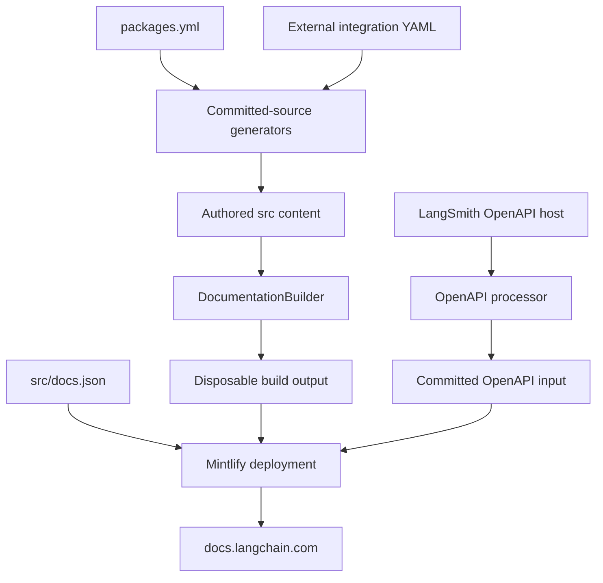

This repository produces the Mintlify site at `docs.langchain.com`; it does not build the separately operated `reference.langchain.com` API-reference site. The core maintenance boundary is durable input versus generated output: `src/` is the authored tree, `src/docs.json` is the Mintlify site contract, and `build/` is disposable output. Do not edit `build/`.

This flow distinguishes repository inputs, regenerated build output, and endpoint pages that Mintlify generates from OpenAPI declarations at deployment.

## Ownership boundaries

| Concern | Durable owner | Safe change boundary |
| --- | --- | --- |
| Page prose, frontmatter, assets, UI fragments, and examples | `src/` | Edit source, not `build/`. |
| Site settings, navigation, redirects, and OpenAPI declarations | `src/docs.json` | Make a navigation and redirect decision in addition to adding or moving a page. |
| Route construction and Markdown transformation | `pipeline/` | Change code and focused pipeline tests, then rebuild. |
| Deployment artifact | `build/` | Regenerate only. |
| Package catalogue | `packages.yml` | Change metadata or its generator, then regenerate committed surfaces. |
| External integration rows | `scripts/data/integration_external_docs.yaml` | Maintain the record rather than a generated MDX table row. |
| LangSmith REST specification | `src/langsmith/langsmith-platform-openapi.json` and processor | Change processing policy or refresh the committed input, not deployment-generated endpoint MDX. |
| Preview artifact | temporary `preview-*` branch | Let the workflow construct and remove it; do not merge it to `main`. |

## Sources, navigation, and routes

`src/` is organized by authoring ownership rather than URL shape. Product content includes `src/langsmith/` and `src/oss/`; reusable MDX and components live in `src/snippets/`; `src/code-samples/` contains executable programs. `AGENTS.md` requires a `src/docs.json` navigation update when adding a page.

`DocumentationBuilder.build_all()` removes and recreates `build/`, renders the OSS families for Python and JavaScript, renders Deep Agents Code and OpenWiki once at unversioned OSS paths, renders LangSmith content, and then copies shared files such as `docs.json`. An emitted source page is not thereby discoverable: `docs.json` independently owns navigation, redirects, and OpenAPI configuration.

Most OSS pages land under `oss/python/` and `oss/javascript/`. `src/oss/openwiki/` and `src/oss/deepagents/code/` intentionally land only under `oss/openwiki/` and `oss/deepagents/code/`; their conditional fences use the Python branch. Both Build-language dropdowns present the same OpenWiki routes. Managed Deep Agents is different: matching `src/langsmith/managed-deep-agents*.mdx` pages emit Python and JavaScript routes only, while the unversioned URLs in `docs.json` redirect to Python routes.

### Preprocessing and containment

Before writing Markdown and MDX, the pipeline resolves `@[...]` cross-references, adds UTM parameters to eligible LangSmith CTA links, and keeps only the target `:::python` or `:::js` content while preserving unsupported conditional labels. The scoped mappings in `pipeline/preprocessors/link_map.py` are the authority for cross-reference URLs; an unresolved symbol is logged and left literal rather than guessed.

Markdown snippets get a default output plus Python and JavaScript copies. Language-targeted MDX imports are rewritten to the matching copy; JSX and TSX snippet components remain shared. This keeps snippet links valid for consumers at arbitrary route depths.

Collection is containment-safe: the builder skips source-tree symlinks and files resolving outside the collection root. Preserve that behavior when changing traversal or adding a source collection.

## API-reference surfaces

Keep these boundaries separate:

- `reference.langchain.com` is generated and deployed outside this repository. This repository can route issue reports but has no reference-site build output to edit.
- `src/docs.json` configures the Agent Server, Control Plane, and LangSmith REST OpenAPI sections. Mintlify generates their endpoint pages during deployment, so those endpoints are neither authored MDX nor local builder output.
- The Agent Server and LangSmith REST declarations use committed specifications; the Control Plane declaration points to `https://api.host.langchain.com/openapi.json`.

The LangSmith REST specification is generated-but-reviewed repository input. `scripts/process_langsmith_openapi.py` allows the live LangSmith host, hides fleet, internal, and health operations, assigns and orders tag groups, and normalizes visible operation titles before writing `src/langsmith/langsmith-platform-openapi.json`. Its daily workflow does not commit unchanged output and appends updates to the standing `chore/refresh-langsmith-openapi` PR.

## Development, validation, publication, and preview

The `docs` console script exposes the pipeline CLI. `docs dev` performs an initial build unless `--skip-build` is selected, watches `src/`, and starts `mint dev` from `build/`; an initial-build failure prevents server startup. Use `make build`, `make dev`, and the link-check targets as standard wrappers.

CI invokes reusable test, lint, and link workflows, cancelling an in-progress run for the same workflow and Git ref when a newer push arrives. Separate jobs check merge-conflict markers, cross-references, external integration URL schemes, and generated files. The reusable link workflow validates built links, anchors, redirects, and the Agent Server OpenAPI specification. CI regenerates the Python provider overview and rejects drift except for explicit automation and label bypasses.

Publication is separate: a `main` push builds the docs, verifies `build/`, nests it as `public/build`, and publishes that directory to the `prod` branch.

A pull request or manual dispatch also drives the preview workflow. It only creates a preview for same-repository PRs (or manual runs), validates the branch name, builds the site, creates a collision-resistant `preview-<sanitized-prefix>-<timestamp>-<short-sha>` branch containing force-added `build/`, and asks the Mintlify preview API to deploy it. Closed PRs trigger cleanup of matching preview branches; the cleanup refuses to delete a branch without the `preview-` prefix. Fork PRs receive no preview branch because the workflow does not grant them write access.

## Runnable samples and generated integration surfaces

`src/code-samples/` is executable source. `make test-code-samples` runs its supported Python, TypeScript, Java, Kotlin, Go, and shell files; it defaults to parallel execution and serializes known shared LangSmith fixtures. `make code-snippets` extracts marker-delimited regions into the ignored `src/code-samples-generated/` intermediate and renders display MDX under `src/snippets/code-samples/`. Edit and test the program, then regenerate; do not hand-edit either derived layer.

For example, `src/code-samples/deepagents/rag-deep.py` uses `:snippet-start:` and `:snippet-end:` to expose documentation fragments, while `:remove-start:` regions retain executable setup and assertions without displaying them. It exits successfully when `OPENAI_API_KEY` is unavailable, so the sample runner can exercise the suite without that credential; with a key, it fetches selected docs, indexes them, and constructs the Deep Agent example.

`packages.yml` is the package catalogue for generated integration surfaces. Its metadata feeds the Python provider overview, and CI regenerates that overview to reject manual changes. The weekly download workflow updates package counts, regenerates the overview plus integration download and featured snippets, and opens a PR only when those tracked outputs changed.

Integration download tables combine hosted-page frontmatter with `integration_external_docs.yaml`. A YAML entry is a third-party listing whose `docs_url` becomes the name link rather than a hosted guide; accepted schemes are `https://`, `http://`, and a single-slash site-relative path. Use this source for eligible external rows, not handwritten output.

The Monday integration-repository workflow runs the liveness checker with `--write` and maintains one draft PR on `chore/dead-integration-repos`. For a dead third-party GitHub home, the checker can adopt a live third-party GitHub replacement supported by PyPI, npm, or external-doc evidence. It leaves live GitLab, partner-doc, and first-party alternatives for human attention; without a live alternate it delists the package and removes associated listing surfaces.

## Change guide

1. **Add or move a page:** edit source, update `src/docs.json`, and add a redirect when retaining a public URL.
2. **Change routes, language rendering, snippets, or preprocessing:** modify `pipeline/`, preserve containment safety, add focused tests, and rebuild.
3. **Change a runnable example:** edit and test the program in `src/code-samples/`, run `make code-snippets`, and commit rendered snippet MDX rather than the ignored intermediate.
4. **Change provider or integration listings:** choose `packages.yml`, hosted-page frontmatter, or `integration_external_docs.yaml` by ownership, then regenerate.
5. **Change API reference:** update `docs.json`, a committed specification, or `process_langsmith_openapi.py`; never author Mintlify-generated endpoint MDX.
6. **Investigate a broken API-symbol link:** amend the appropriate scoped `link_map.py` entry and verify preprocessing rather than pasting a generated URL into output.
7. **Change preview behavior:** preserve branch-name validation, least-privilege job permissions, same-repository restriction, and safe cleanup semantics.

## Related pages

- [Build system](/openwiki/architecture/build-system.md)
- [Versioning](/openwiki/concepts/versioning.md)
- [GitHub Actions](/openwiki/integrations/github-actions.md)
- [Code sample lifecycle](/openwiki/workflows/code-sample-lifecycle.md)
- [Integration listing automation](/openwiki/workflows/integration-listing-automation.md)
- [Versioned content](/openwiki/workflows/versioned-content.md)
