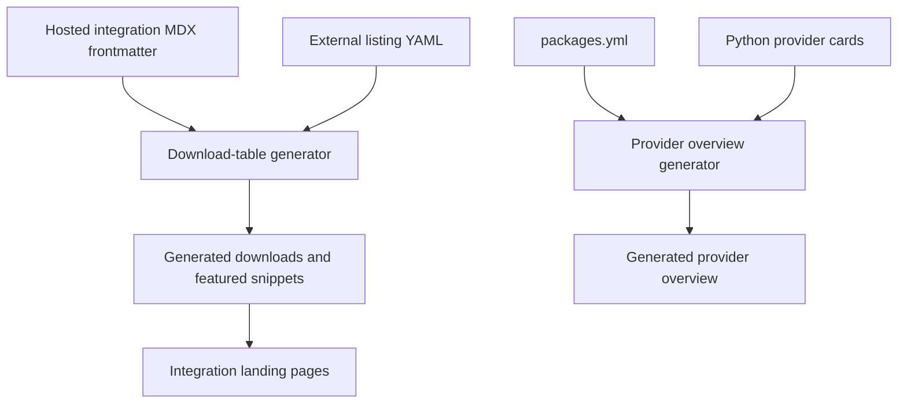
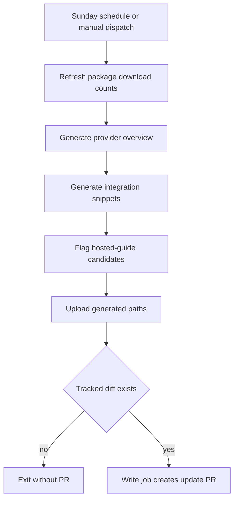

# Integration Listing Automation

Integration discovery is assembled from two separate pipelines. Component download tables combine hosted integration-page metadata with third-party external-listing metadata. The Python provider overview is independently generated from package registry metadata and an authored provider-card catalog. Their committed outputs are public documentation, but they are **derived artifacts**: change the owner and regenerate rather than patching a table or overview by hand.



*Component snippets and the provider overview have distinct authored inputs and generators.*

## Choose the listing surface

A full hosted guide is appropriate only for an integration with at least 50,000 monthly PyPI or npm downloads, or when maintainers have made a featured decision. Otherwise, the integration is listed externally: the listing points to partner-maintained documentation rather than adding a hosted MDX guide. This is a curation rule, not a reason to set `featured: true` yourself. When moving an integration to a hosted guide, remove the duplicate external row.

| Surface | Authoritative owner | What it contributes | Do not edit |
| --- | --- | --- | --- |
| Hosted integration | `src/oss/{python,javascript}/integrations/<component>/**/*.mdx` frontmatter | `integration.name`, the language-specific `pypi` or `npm` package, optional featured/deprecated flags, and component capabilities | Generated component snippets |
| External integration | `scripts/data/integration_external_docs.yaml` | Language/component row, display name, registry package, `docs_url`, and applicable capabilities | Generated component snippets |
| Provider discovery | `packages.yml` plus Python `all_providers.mdx` cards | Package eligibility, ordering, package/repository/reference links, and provider-card destinations | `src/oss/python/integrations/providers/overview.mdx` |

For example, the Python Azure Cosmos DB vector-store guide declares a package, a featured flag, and vector-store capability values in `integration:` frontmatter. Its JavaScript counterpart declares its `npm` package in the same metadata structure. These are source facts used to construct their respective tables; the narrative content of a guide is not parsed for a row.

`packages.yml` is the package registry source of truth. Its comments define `integration: false` as exclusion from the integrations list and reserve `highlight` for maintainers; highlighted packages bypass the overview's normal download threshold and sort first. The external YAML is the corresponding canonical source for rows that do not have hosted guides. Prefer a partner documentation URL, then a public repository, then PyPI or npm for `docs_url`.

## Component download snippets

`refresh_integration_downloads.py` scans supported Python and JavaScript component directories recursively, skipping index, template, and example-data MDX. It reads the `integration:` mapping from hosted pages, appends rows from the external YAML for the same language and component, and sorts rows by known downloads descending and then name; rows with unavailable downloads come last. Hosted names link to `/oss/integrations/<component>/...`; external names link to their `docs_url`.

The generator writes snippets under `src/snippets/oss/` with a generated-file warning. It always emits an all-rows `*-downloads.mdx` table for a nonempty component; it emits `*-featured.mdx` for chat and for any other component containing featured rows. Python and JavaScript component index pages import the download snippets—for example, the Python tools landing page imports `python-tools-downloads.mdx`—so an apparently local snippet edit changes a rendered documentation surface.

Table shape follows the component metadata rather than a universal schema:

- Chat rows have stream, tool-calling, structured-output, and multimodal columns.
- Middleware and retriever rows have their own text or capability/package columns.
- Vector-store feature columns appear only if at least one collected row defines that capability; boolean values carry sort values for the client-side table.

### External URLs are an input-security boundary

External `docs_url` values may be HTTP(S) URLs or site-relative paths beginning with one `/`. Protocol-relative `//...`, blank values, and schemes such as `javascript:`, `data:`, and `vbscript:` are not safe link targets. `--check-docs-urls` reports missing or unsafe YAML values without network access or writes. During normal collection a missing external URL skips that row with a warning, while an unsafe external URL stops generation; a hosted row with an unsafe optional URL falls back to its internal route instead of rendering it.

Registry collection is intentionally best effort. PyPI and npm calls retry rate-limit responses up to six times with exponential backoff, and a cache avoids duplicate registry/package lookups within a run. Other request, parse, or missing-data failures yield an unavailable row rather than aborting the complete table refresh.

Run from the repository root:

```bash
uv run python scripts/refresh_integration_downloads.py --check-docs-urls
uv run python scripts/refresh_integration_downloads.py --write
```

Use `--language` and `--component` to constrain a regeneration to supported values or `all`. Without `--write`, the generator prints the proposed tables. Correct the hosted frontmatter, external YAML, or generator and rerun; do not retain a manual correction in a generated snippet.

## Python provider overview

`pipeline/tools/partner_pkg_table.py` generates `src/oss/python/integrations/providers/overview.mdx`, marking it as automatically generated. It excludes core packages, keeps packages with at least 100,000 downloads unless `highlight` is set, sorts highlighted packages before the remainder by downloads, and caps the table at 50 rows. It rejects `has_reference_docs: true` combined with `integration: false`.

The overview's provider destination is resolved deliberately, in this order:

1. An absolute `provider_page` from `packages.yml`.
2. A hosted provider page named by `provider_page` or derived `name_short`.
3. A matching authored card href from `src/oss/python/integrations/providers/all_providers.mdx`, including an external URL.
4. The package's GitHub repository, then its PyPI page.

Provider cards are curated discovery content, not generated output. The generator parses the Python `all_providers.mdx` card titles and hrefs, including variants of card titles and local provider slugs, to make the third step work. Thus a card link can intentionally override the repository/PyPI fallback without changing the package record. The JavaScript provider-card catalog is not an input to this Python-only generator.

Regenerate after changing package metadata, a relevant Python card, or the generator:

```bash
uv run python pipeline/tools/partner_pkg_table.py
```

CI reruns this command and fails if the committed overview differs, explicitly directing contributors to `packages.yml` or `partner_pkg_table.py` rather than the overview file.

## Scheduled refresh and hosted-guide follow-up

The `Update Package Downloads` workflow runs Sundays at 23:59 UTC and also supports manual dispatch. Its read-only generation job updates package download counts, builds the provider overview, regenerates integration snippets, and evaluates external listings for possible hosted documentation. It uploads only `packages.yml`, the overview, and the generated download/featured snippets as an artifact. A second job with write permissions downloads that restricted artifact and opens a timestamped maintenance PR only when those tracked paths differ; it enables squash auto-merge for that PR.



*The scheduled workflow separates read-only generation from the conditional repository-writing job.*

The candidate flagger reads external YAML entries, fetches the same registry metrics, and identifies entries at the 50,000-download threshold. It is dry-run unless both `LINEAR_API_KEY` and `LINEAR_TEAM_KEY` are available. When creation is enabled, its stable title search term omits the changing download count so existing open Linear work is not duplicated. A candidate is a maintainer follow-up signal, not an automatic conversion to a hosted guide.

## Change and validation checklist

1. Decide whether the integration belongs in a hosted guide or external listing under the eligibility rule.
2. Change the owning metadata: hosted `integration:` frontmatter, external YAML, `packages.yml`, an authored Python provider card, or a generator.
3. For an external listing, supply the correct language/component, name, language registry package, partner-owned `docs_url`, and only known component capabilities.
4. Validate external URLs and regenerate component snippets. Regenerate the overview when its input path changed.
5. Review generated links, language/component placement, feature/capability columns, ordering, and unavailable-download behavior.
6. Run the focused URL tests when changing URL validation or rendering:

   ```bash
   uv run pytest tests/unit_tests/test_refresh_integration_downloads.py
   ```

The focused test module covers allowed and unsafe URL schemes, fallback away from an unsafe rendered href, repository-YAML validation, and Markdown-cell normalization. CI also runs the URL-check mode and the provider-overview drift check.

## Related pages

- [Repository Source Map](/openwiki/architecture/source-map.md)
- [GitHub Actions and CI Automation](/openwiki/integrations/github-actions.md)
- [Adding pages](/openwiki/operations/adding-pages.md)
- [Quickstart](/openwiki/quickstart.md)
- [Testing and Validation Overview](/openwiki/testing/test-overview.md)
